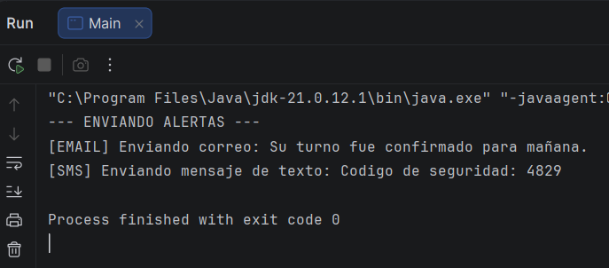

- Diseño de Software - Módulo 3
Ejercitación - Patrón Factory Method
Ejercicio 3: Sistema de Notificaciones Multiplataforma Básico
Contexto del problema:
Una plataforma de servicios requiere enviar alertas a sus usuarios a través de diferentes canales (como Correo Electrónico y Mensajes de Texto SMS) utilizando una interfaz unificada de envío.

Objetivo de aprendizaje:
Utilizar el patrón Factory Method para estandarizar la creación de objetos que comparten un contrato común de comportamiento.

Requisitos funcionales:

Definir un contrato de notificación que reciba un mensaje de texto y ejecute su envío simulado.

Crear factorías concretas encargadas de producir notificadores por correo y por SMS de forma independiente.

Restricciones técnicas:

Las clases consumidoras de las notificaciones deben interactuar exclusivamente con la interfaz abstracta del canal de envío.

La creación de los objetos de notificación debe resolverse exclusivamente a través de los métodos de fábrica correspondientes.
***
# Lógica y Funcionamiento del Programa:
    Para este ejercicio implementé el patrón Factory Method para estandarizar cómo se envían las alertas sin importar si salen por mail o por mensaje de texto.

- Interfaz Notificador: Define el contrato común con el método enviar(), obligando a que todos los canales reciban un texto y lo envíen de la misma forma.

- Clases NotificadorEmail y NotificadorSms: Son las clases concretas que implementan la interfaz y simulan el envío por consola según el canal correspondiente.

- Clase FabricaNotificaciones: Es la clase abstracta base que declara el método de fábrica crearNotificador() y un método auxiliar para mandar el mensaje directo.

- Clases FabricaEmail y FabricaSms: Son las factorías específicas. Cada una sobrescribe el método de fábrica para instanciar y devolver únicamente su notificador.

- Clase Main: En la prueba instancié las fábricas en lugar de hacer new sobre los notificadores. De esta forma, el código principal interactúa siempre contra la interfaz Notificador y no queda atado a ningún canal en particular.
***
# Ejecucion por consola
